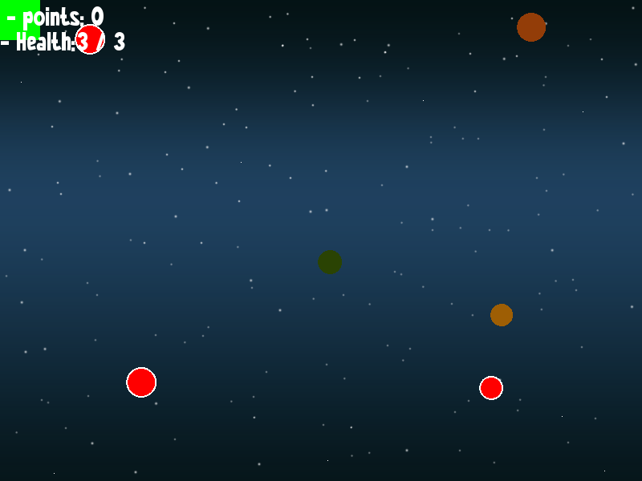

# Color Slicer 🎮

A dynamic 2D arcade game built with **C++** and the **SFML (Simple and Fast Multimedia Library)** framework. Control your character, collect colored balls to increase your score, restore health with healing balls, and dodge hazardous damaging balls to stay alive!



---

## 👥 Group Members

| Registration No | Name |
| :--- | :--- |
| **23/ENG/131** | A.Senthuran |
| **23/ENG/132** | B.Shangeeth |
| **23/ENG/170** | Piruththika |

---

## ✨ Features

- **Fluid 2D Gameplay**: 60 FPS real-time game loop with responsive keyboard controls.
- **Multiple Ball Types**:
  - 🎨 **Default Colored Balls**: Collect to increase your points (+1 score).
  - 💚 **Healing Balls (Green with white outline)**: Restores player health (+1 HP).
  - 🔴 **Damaging Balls (Red with white outline)**: Deals hazard damage (-1 HP).
- **Interactive Heads-Up Display (HUD)**: Real-time points counter and health bar monitor.
- **Background Music & Audio**: Immersive background music streaming.
- **Pause & Resume Menu**: Pause the game at any moment with options to resume, restart, or quit.
- **In-Game Screenshot Utility**: Press <kbd>F12</kbd> anytime to capture screenshots.

---

## 🕹️ Controls

| Key | Action |
| :--- | :--- |
| <kbd>W</kbd> / <kbd>Up Arrow</kbd> | Move Up |
| <kbd>A</kbd> / <kbd>Left Arrow</kbd> | Move Left |
| <kbd>S</kbd> / <kbd>Down Arrow</kbd> | Move Down |
| <kbd>D</kbd> / <kbd>Right Arrow</kbd> | Move Right |
| <kbd>P</kbd> | Pause Game |
| <kbd>C</kbd> | Resume (in Pause menu) |
| <kbd>R</kbd> | Restart (in Pause menu) |
| <kbd>Q</kbd> | Quit (in Pause menu) |
| <kbd>F12</kbd> | Save Screenshot (`screenshot.png`) |
| <kbd>Esc</kbd> | Exit Game |

---

## 🛠️ Tech Stack & Requirements

- **Language**: C++17 or later
- **Graphics & Audio Library**: SFML 2.5 (Included in `External/SFML`)
- **IDE / Toolchain**: Visual Studio 2022 (MSVC v143 / x86 Win32)

---

## 🚀 How to Build and Run

1. **Clone the repository**:
   ```bash
   git clone https://github.com/shangeeth2k22/Color-slicer.git
   cd Color-slicer
   ```

2. **Open in Visual Studio**:
   - Double-click `SFMLLinkTest.sln`.
   - Ensure the solution configuration is set to **Debug** or **Release** and platform **x86** (Win32).

3. **Build & Run**:
   - Press <kbd>F5</kbd> (or <kbd>Ctrl</kbd>+<kbd>F5</kbd>) to compile and run.
